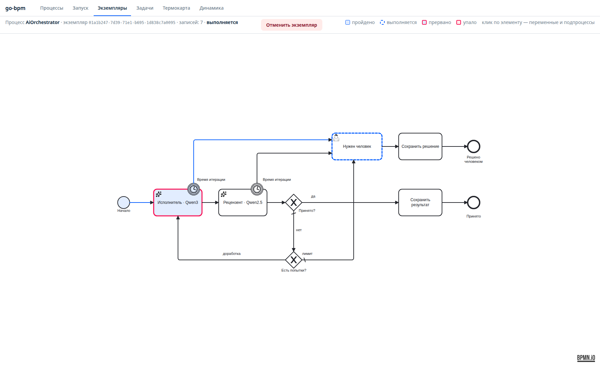
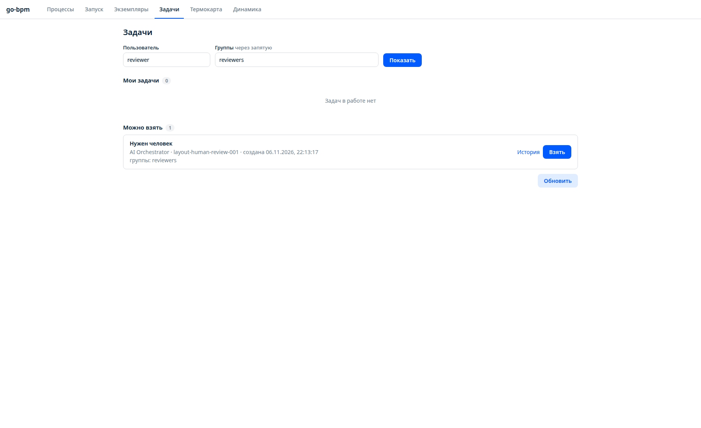
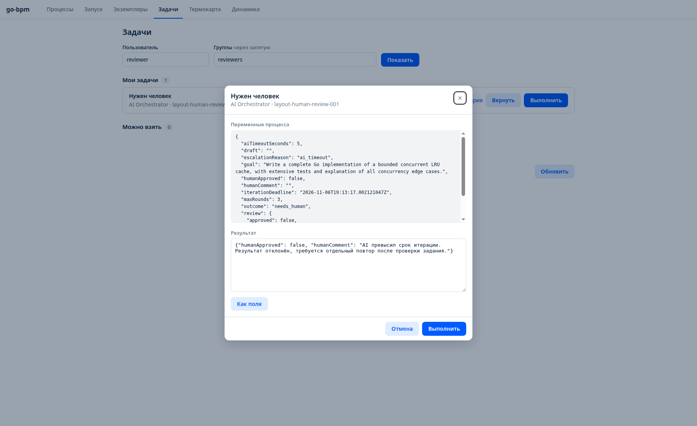
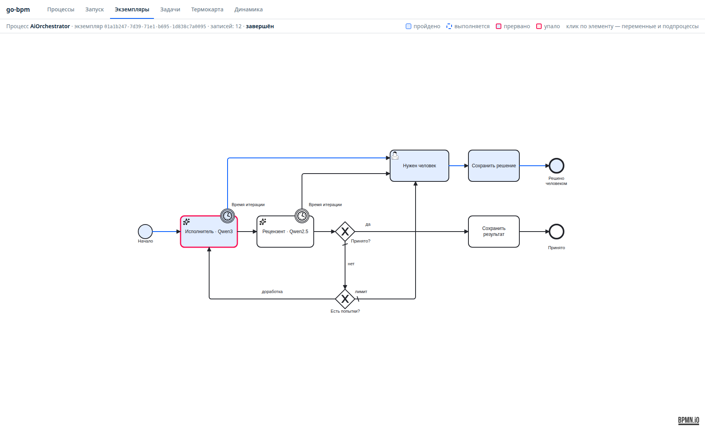

# Схема без технических блоков

6 ноября 2026 года геометрия и маршруты BPMN обновлены пользователем в моделлере. Удалены задачи `Prepare`, `Escalate` и `MarkTimeout`. Старт и возврат ведут прямо к исполнителю; таймеры и исчерпание попыток — прямо к пользовательской задаче. Файл BPMN сохранён без дополнительных изменений.

Для сохранения поведения добавлен пакет `internal/orchestration`:

- На переходах к `Write` вызывается подготовка итерации: значения по умолчанию, проверка ввода, увеличение `round`, новый `iterationDeadline`.
- На переходах к `HumanReview` записываются `outcome: needs_human` и `escalationReason`. Причина определяется по источнику входящего перехода: граничное событие или ветка лимита.
- Это рукописное дополнение сгенерированного графа в `orchestration.Processes(svc)`, без изменений движка и генератора. Обработчики выполняются в транзакции перехода. В истории их события привязаны к стрелкам, отдельные блоки на диаграмме не появляются.
- Тесты и приложение используют один и тот же дополненный граф. Генерация по исходному BPMN воспроизводима.

Пройден реальный сценарий с Qwen, `aiTimeoutSeconds: 5`, бизнес-ключ `layout-human-review-001`, экземпляр `01a1b247-7d39-71e1-b695-1d838c7a0095`. Таймаут исполнителя создал задачу `HumanReview`; пользователь `reviewer` взял и завершил её с отклонением и комментарием. Итог — `completed`, `rejected_by_human`.

[История прогона](layout-human-run.json).

Все шесть интеграционных сценариев проходят с PostgreSQL и детектором гонок: принятие моделью, доработка, лимит с ручным принятием и отклонением, таймаут каждой из моделей с отбрасыванием запоздалого ответа. Также прошли полные тесты, сборка и `go vet`.
