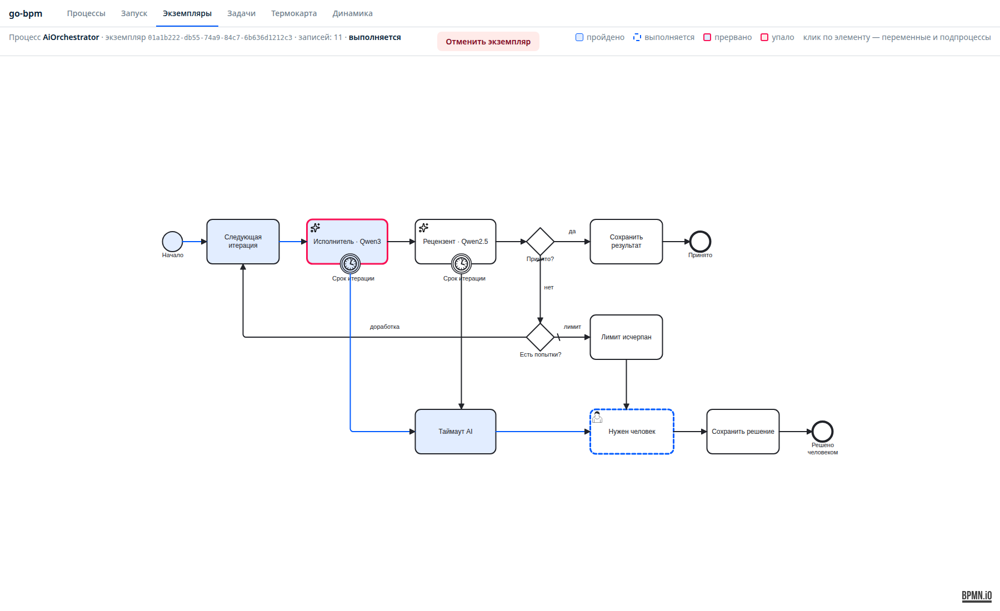
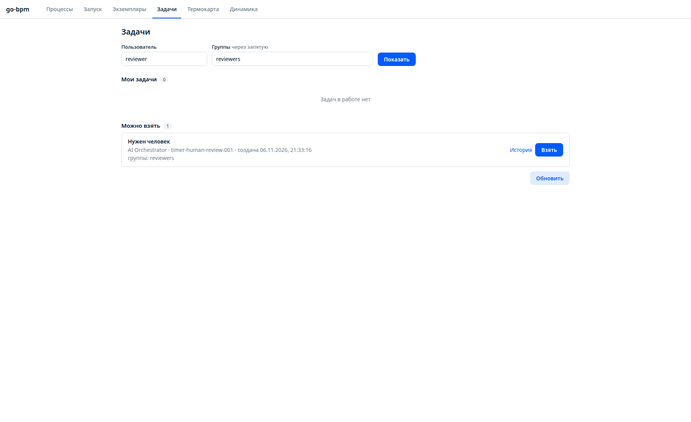
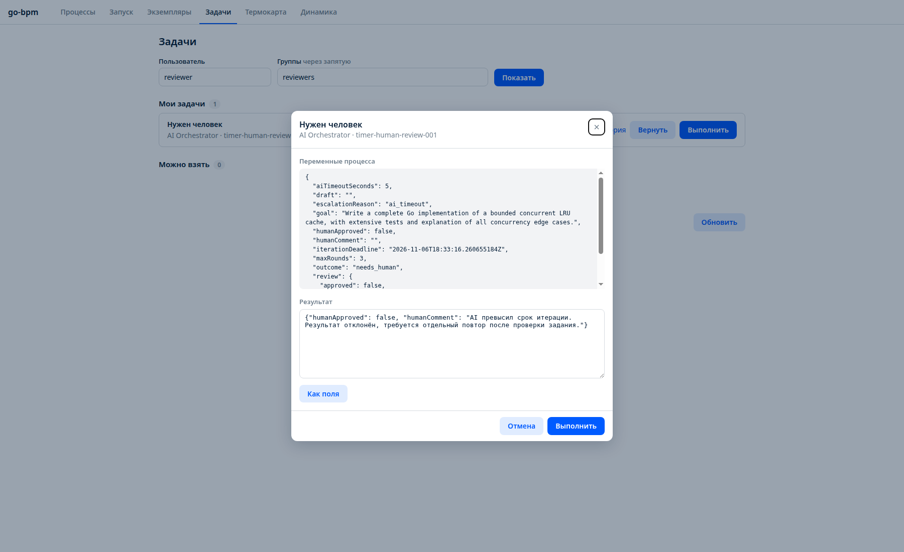
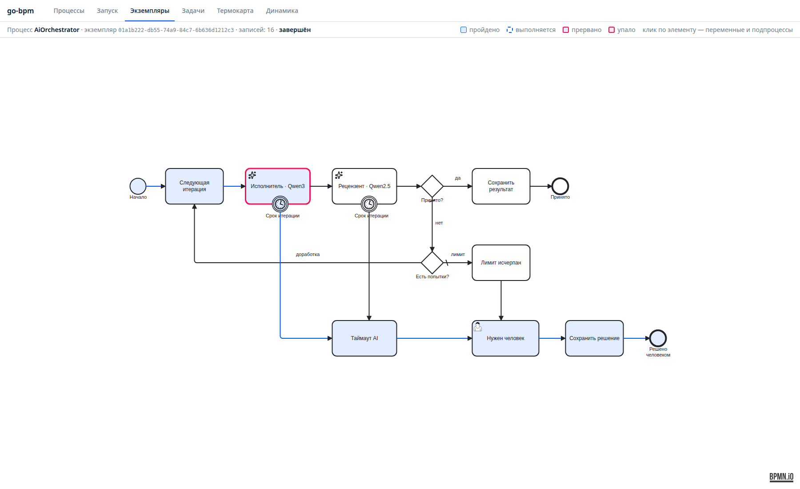

# Таймаут и пользовательская задача

Добавлено 6 ноября 2026 года к первоначальному эксперименту.

## Поведение

- На `Write` и `Review` — прерывающие граничные таймеры с `timeDate = iterationDeadline`.
- Общий срок пары вызовов задаётся `aiTimeoutSeconds`: по умолчанию 120 секунд, для показательного прогона 5 секунд. Новый цикл доработки получает новый срок.
- Таймаут ведёт через `MarkTimeout` к пользовательской задаче `HumanReview`; исчерпание итераций — через `Escalate` к той же задаче.
- Группа кандидатов — `reviewers`; до ответа человека экземпляр остаётся `running`, исход `needs_human`.
- Человек передаёт `humanApproved` и `humanComment`. После выполнения задачи метод `ResolveHuman` записывает `approved_by_human` или `rejected_by_human`, затем процесс завершается.

## Реальный прогон

Экземпляр `01a1b222-db55-74a9-84c7-6b636d1212c3`, бизнес-ключ `timer-human-review-001`. Запросили у реальной Qwen развёрнутую реализацию конкурентного LRU-кеша с тестами, указав `aiTimeoutSeconds: 5`.

Таймер `WriteTimeout` сработал, задача исполнителя помечена прерванной. Создана задача «Нужен человек», `escalationReason: ai_timeout`, процесс продолжил ждать. Через настоящий интерфейс консоли пользователь `reviewer` группы `reviewers` взял задачу и выполнил её с `humanApproved: false` и комментарием о превышении срока. Итог: `completed`, `outcome: rejected_by_human`.

[История прогона и выполненная задача](timer-human-run.json).

## Скриншоты

Скрипт `scripts/screenshots_timeout.py` снимает реальную консоль, берёт задачу и завершает её с отклонением результата; для воспроизведения нужен отдельный экземпляр, ожидающий `HumanReview`. Снимки первой версии в исходном журнале сохранены.

## Проверки

С PostgreSQL и `-race` проходят шесть сценариев:

1. Принятие моделью сразу.
2. Доработка по замечаниям и принятие моделью.
3. Лимит попыток и принятие человеком.
4. Лимит попыток и отклонение человеком.
5. Таймаут исполнителя, затем отклонение человеком.
6. Таймаут рецензента, затем принятие человеком.

Тесты таймаута удерживают ответ AI до завершения ручного решения, затем освобождают обработчик и ждут его окончания. Проверяется, что поздний ответ не завершает прерванную задачу и не перезаписывает исход и комментарий человека. Обычные сценарии также проверяют снятие невостребованных таймеров через завершение процесса до установленного срока.
